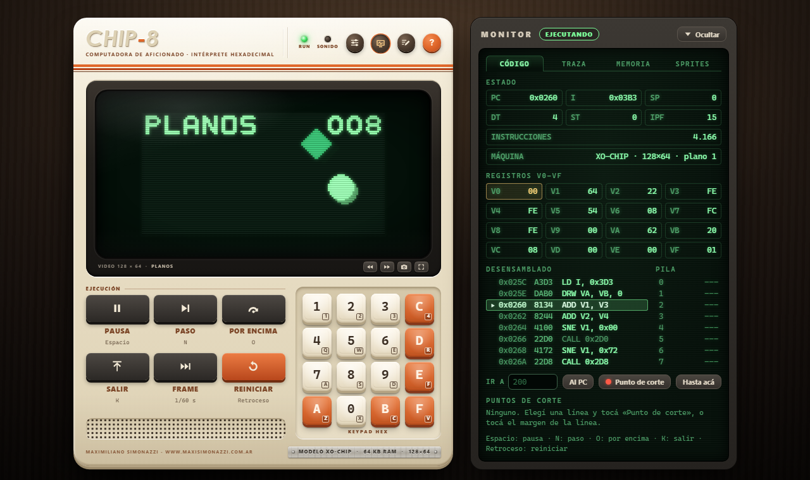

# chip8-emulator

Un emulador de CHIP-8 que cabe en un solo archivo, [`chip8.html`](chip8.html). Se abre con
doble clic y funciona sin instalar nada y sin conexión. Además de CHIP-8 corre SUPER-CHIP y
XO-CHIP, y está armado como una computadora de aficionado de fines de los setenta: tubo de
rayos catódicos, keypad hexadecimal y un monitor al costado para ver qué hace el programa por
dentro.



## Qué hay adentro

CHIP-8 no fue una consola sino un lenguaje interpretado que Joseph Weisbecker escribió en
1977 para la RCA COSMAC VIP. El emulador tiene las 35 instrucciones originales, las de
SUPER-CHIP (pantalla de 128×64, scroll, sprites de 16×16, fuente grande) y las de XO-CHIP
(64 KB de memoria, dos planos de dibujo que dan cuatro colores, sonido con patrones). Los
detalles en los que los intérpretes de cada época no se ponen de acuerdo, los *quirks*, se
cambian con interruptores; de fábrica se comporta como el VIP.

Trae seis cartuchos escritos para este proyecto: una pelotita que rebota, un visor del
teclado, un juego de atrapar bloques, un programa que se prueba a sí mismo, la fuente
hexadecimal y una muestra de XO-CHIP. En [`roms/archivo/`](roms/archivo/LEEME.md) están
además los 104 juegos del archivo de la comunidad que mantiene John Earnest, el autor de Octo,
que son de dominio público. La consola los reconoce por su huella SHA-1 y se configura sola
con la plataforma, la velocidad y los colores de cada uno. Una ROM que no está en esa lista
arranca con tus ajustes; si los cambiás mientras la jugás, los recuerda para la próxima vez.

Para entender un programa hay un monitor con los registros, la pila, el desensamblado y la
memoria, ejecución de a una instrucción, cinco ranuras de estado por cartucho y rebobinado:
mientras mantenés apretada la B, la máquina vuelve hacia atrás hasta medio minuto.

## Cómo se usa

Abrí `chip8.html` en Chrome o Edge. Arranca con el primer demo; los otros están debajo de la
ranura, y cualquier `.ch8` se carga con «Cargar ROM» o arrastrándolo a la página. El sonido
se habilita con el primer clic o la primera tecla, porque el navegador no deja reproducir
nada antes.

El keypad del COSMAC VIP está en el bloque izquierdo del teclado. Se toma la posición de cada
tecla y no la letra, así que da igual la distribución:

```
Tu teclado     Keypad CHIP-8
1 2 3 4        1 2 3 C
Q W E R        4 5 6 D
A S D F        7 8 9 E
Z X C V        A 0 B F
```

### Atajos

| Tecla | Qué hace |
|---|---|
| Espacio | Pausa o sigue |
| N | Ejecuta una sola instrucción |
| O | Paso por encima: ejecuta un `CALL` entero |
| K | Sale de la subrutina |
| Retroceso | Reinicia la ROM |
| H | Abre la ayuda |
| L | Abre el archivo de la comunidad: los juegos de la Octojam, para cargarlos con un clic |
| T (mantenida) | Avance rápido: cuatro veces más rápido, timers incluidos |
| P | Pantalla completa |
| G | Guarda una captura en PNG |
| Y | Abre o cierra el Taller: escribís un programa, lo ensamblás y corre en la consola |
| I | Guarda el estado en la ranura rápida |
| U | Carga la ranura rápida |
| B (mantenida) | Rebobina |
| ↑ ↓ ← → | Las teclas del keypad que elijas en «Controles» (de fábrica, 5, 8, 7 y 9) |
| Esc | Cierra los diálogos |

Si un juego bajado de internet anda lento o hace cosas raras, casi siempre es el perfil y no
el emulador. Los juegos hechos con Octo quieren el perfil XO-CHIP aunque sean de CHIP-8
común; la sección [12.2 del manual](docs/MANUAL.md#122-instrucciones-por-frame-ipf) lo
explica con más detalle.

## Documentación

[El manual](docs/MANUAL.md) es una referencia de CHIP-8 de punta a punta: la historia, la
máquina, cada instrucción con su ejemplo y los quirks de cada intérprete.
[El tutorial](docs/TUTORIAL.md) va de usar la consola a escribir programas propios con el
ensamblador incluido. [DESARROLLO.md](docs/DESARROLLO.md) cuenta cómo está hecho, por qué se
decidió cada cosa y cómo se verificó.

## Desarrollo

No hay dependencias. Node 22 o más nuevo hace falta solo para las pruebas y las
herramientas.

```bash
npm test
```

Son **1602 pruebas** en 22 archivos y tardan unos segundos. Además de cada instrucción y cada
quirk, revisan el ensamblador, los demos, los estados guardados, la tabla del archivo y que
la documentación no mienta: los ejemplos del manual y del tutorial se ensamblan y se
ejecutan. `npm run e2e` corre 76 escenarios en Chrome o Edge sin ventana, con teclado, mouse
y toques de verdad.

Las otras herramientas:

- `npm run asm -- programa.asm` ensambla un programa. La sintaxis está explicada al principio
  de `tools/chip8asm.js`.
- `npm run roms` vuelve a armar los cartuchos incluidos a partir de `roms/*.asm`.
- `npm run archive -- download` baja las ROMs del archivo; `update` actualiza su tabla y
  `test` corre todos los juegos y arma una hoja con sus pantallas.
- `npm run serve` sirve el proyecto en localhost:8008. Para usar la consola no hace falta:
  está para las pruebas.

## Estructura del repositorio

```
chip8.html                   La consola entera: estilos, interfaz, núcleo, cartuchos y la tabla del archivo.
roms/                        Los seis cartuchos incluidos, en assembler (.asm) y ensamblados (.ch8).
roms/archivo/                Los 104 juegos del archivo de la comunidad y su índice.
data/archive.json            Los datos del archivo: huellas, plataformas y opciones de Octo.
tools/chip8asm.js            El ensamblador.
tools/embed-roms.js          Arma el bloque de cartuchos de chip8.html.
tools/archive.js             Baja el archivo, arma su tabla y prueba sus juegos.
tools/e2e.js                 Las pruebas de punta a punta en el navegador.
tools/serve.js               Un servidor estático mínimo.
tests/                       Las pruebas, con node:test; harness.js carga los bloques de chip8.html.
docs/MANUAL.md               El manual de referencia.
docs/TUTORIAL.md             El tutorial.
docs/ejemplos/               Los programas del tutorial.
docs/DESARROLLO.md           La documentación del desarrollo.
```

## Lo que no hace

No ejecuta código de máquina del RCA 1802: las instrucciones `0NNN` se ignoran. Tampoco imita
las rarezas de SUPER-CHIP en la calculadora HP-48 (el scroll de medio píxel en baja
resolución, las colisiones que cuentan filas). No compila fuentes de Octo (`.8o`); hay que
cargar la ROM ya armada. Las pruebas de navegador corren en Chrome: no se probó en un
teléfono de verdad, con un joystick físico ni en Firefox o Safari. De los 104 juegos del
archivo, *supersquare* se detiene en su pantalla de fin por un desborde de pila que también
tiene en Octo.

## Licencia

El código es MIT. Las ROMs de `roms/archivo/` y los datos de `data/archive.json` vienen del
[archivo de John Earnest](https://github.com/JohnEarnest/chip8Archive) y son CC0.
